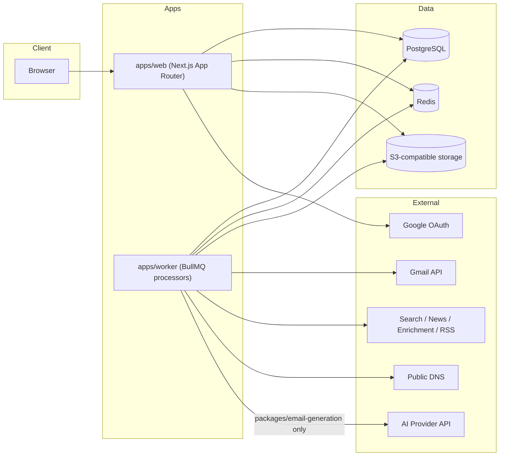

# Architecture

Mail Orbyt is a TypeScript pnpm monorepo with two deployable apps and a set
of domain packages consumed by both.

## System overview

## Why a monorepo

Leads, research, generation, Gmail, campaigns, scheduling, conversations,
analytics, and compliance are separable domains with independent test
suites, but they share the same database schema and design system. A
monorepo with strict package boundaries (enforced by
`tests/architecture/ai-boundary.test.ts` and ESLint's
`no-restricted-imports`) gives us domain separation without the operational
overhead of separate repos/deploys for what is, at this stage, a single
product.

## Package boundaries

- **apps/web** — Next.js App Router UI and route handlers (API). Never
  imports provider SDKs directly; always goes through a domain package.
- **apps/worker** — BullMQ job processors. Same provider-access rule as web.
- **packages/database** — Prisma schema and client. The only package that
  talks to PostgreSQL directly.
- **packages/config** — Environment variable loading and validation. The
  only place `process.env` should be read from directly in application code.
- **packages/email-generation** — The only package permitted to import an AI
  provider SDK. See `docs/ai-boundaries.md`.
- **packages/gmail** — Wraps the Gmail API and Google OAuth token lifecycle
  for sending inboxes (distinct from application login).
- **packages/research** — Deterministic enrichment providers and extraction.
  Never imports an AI SDK.
- **packages/leads**, **campaigns**, **scheduling**, **conversations**,
  **analytics**, **compliance** — domain services consumed by both apps.
- **packages/design-system** — Material 3 tokens and React components.
- **packages/authentication** — Auth.js configuration, session/role helpers.
- **packages/validation** — Shared Zod schemas and primitives.
- **packages/logging** — Structured JSON logger with field redaction.

## Data flow principles

- All timestamps are stored in UTC. Timezone conversion happens explicitly
  at the point of scheduling/display (see `docs/scheduler.md`, Phase 8).
- State transitions that must be consistent (campaign lead state, outbox
  status, suppression checks) run inside a database transaction.
- Background jobs are idempotent: every job that mutates state derives a
  stable idempotency key from immutable inputs (see `docs/outbox-pattern.md`,
  Phase 8) rather than relying on at-most-once delivery from the queue.
- Tenant isolation is enforced in the service layer, not just at the
  database layer: every query that touches tenant-scoped data takes an
  `organisationId` derived from the authenticated session, never from
  client-supplied input.

## Phases

The product is built in 13 phases (0–12), each independently tested and
audited before the next begins. See the root of this repo's task history or
`README.md` for the current phase list and status.
