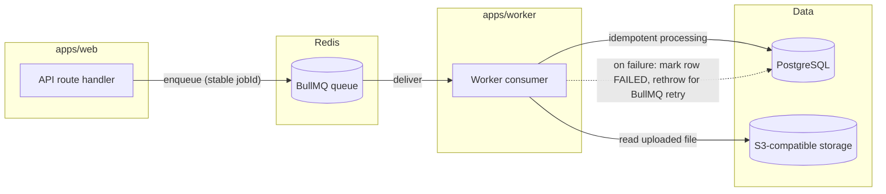

# Queue architecture

Background work runs on BullMQ (Redis-backed) queues, processed by
`apps/worker`. `apps/web` only ever enqueues; it never processes a job
inline on a request thread.

## Queues implemented so far

| Queue         | Producer                                                                               | Consumer                                | Job body                               |
| ------------- | -------------------------------------------------------------------------------------- | --------------------------------------- | -------------------------------------- |
| `lead-import` | `packages/leads`' `enqueueImportJob` (called from `apps/web`'s leads-import API route) | `apps/worker/src/queues/lead-import.ts` | `packages/leads`' `processImportBatch` |

Future phases add: research jobs (Phase 4), email generation jobs (Phase
5), scheduled-send jobs and the outbox sweep (Phase 8), reply-sync polling
(Phase 9).

## Conventions every queue follows

- **Idempotent job bodies.** A job may be redelivered (crash, retry,
  duplicate enqueue) and must produce the same end state as running once.
  `processImportBatch` checkpoints progress at the row level via a unique
  DB constraint rather than assuming at-most-once delivery.
- **Stable, derived job IDs.** `enqueueImportJob` derives its BullMQ
  `jobId` from the batch ID (`import-batch-<id>`, not `import-batch:<id>` —
  BullMQ rejects `:` in custom job IDs, a real bug caught only by enqueuing
  against real Redis) so accidentally enqueuing the same unit of work twice
  reuses the same job instead of running it concurrently.
- **Bounded retries with backoff.** `attempts: 3` with exponential backoff;
  a job that keeps failing lands in BullMQ's own failed-job list
  (`removeOnFail: false`) rather than being silently dropped. A proper
  dead-letter queue and replay tooling are built out in Phase 8.
- **Workers never import the AI provider SDK.** Same architecture boundary
  as everywhere else — see `docs/ai-boundaries.md`.
